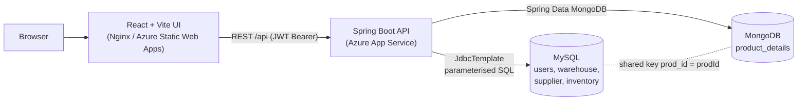
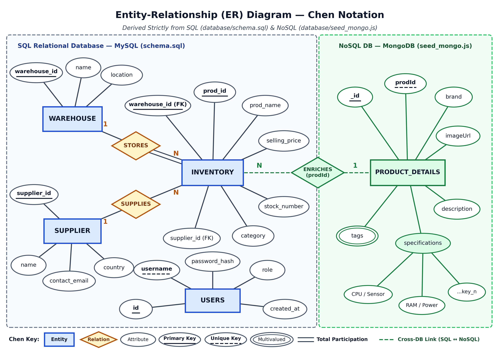
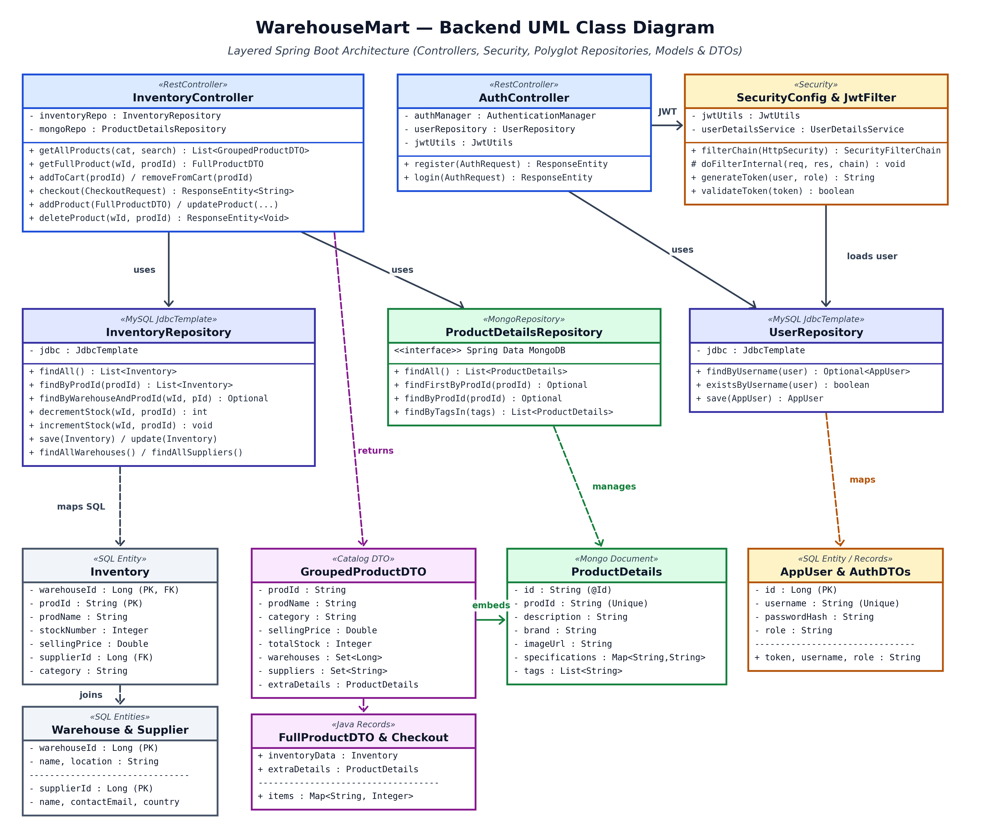
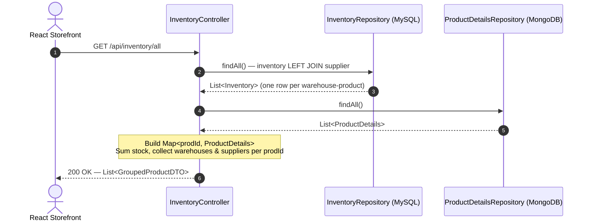
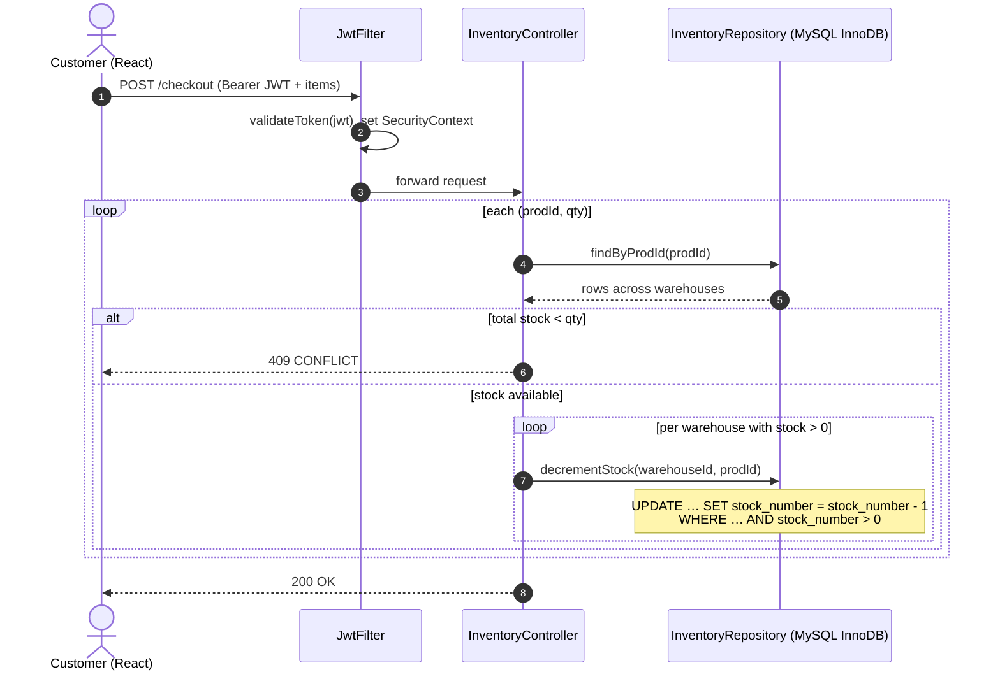

# WarehouseMart — Multi-Warehouse E-Commerce Platform

**Course:** 23AIE303 – Database Management Systems (Project)
**Repository:** https://github.com/Raaman333/warehouse-ecommerce

| Live demo (Azure) | URL |
|---|---|
| Storefront (Azure Static Web Apps) | https://icy-field-021774800.5.azurestaticapps.net |
| REST API (Azure App Service) | https://warehousemart-app-dmc9ajdkhzdmgda4.uaenorth-01.azurewebsites.net |

## Team Members

| Roll No. | Name |
|---|---|
| CB.SC.U4AIE24109 | Praneeth D. |
| CB.SC.U4AIE24117 | Jyothsna V. |
| CB.SC.U4AIE24148 | Raaman N. |
| CB.SC.U4AIE24165 | Sudeepthi U. |

---

## Table of Contents
1. [Project Overview & Problem Statement](#1-project-overview--problem-statement)
2. [System Requirements & Architecture](#2-system-requirements--architecture)
3. [ER Diagram & UML Diagrams](#3-er-diagram--uml-diagrams)
4. [Relational Schema Mapping](#4-relational-schema-mapping)
5. [Normalization & Functional Dependencies](#5-normalization--functional-dependencies)
6. [Methodology & Database Design](#6-methodology--database-design)
7. [Advanced SQL Queries](#7-advanced-sql-queries)
8. [Installation, Setup & Execution](#8-installation-setup--execution)
9. [Demonstration Instructions](#9-demonstration-instructions)
10. [Test Cases & Validation](#10-test-cases--validation)
11. [Screenshots](#11-screenshots)
12. [Repository Structure](#12-repository-structure)
13. [Conclusion & Future Scope](#13-conclusion--future-scope)

---

## 1. Project Overview & Problem Statement

### Background
India's e-commerce landscape is dominated by quick-commerce platforms (Blinkit, Zepto, Instamart). They are convenient for customers but disadvantage small independent vendors through onboarding fees, commission cuts, strict listing rules, and **inventory lock-in** (stock must sit in the platform's own dark stores), which removes the vendor's control over their stock.

### Problem Statement
> *Development of a relational database-backed e-commerce application that enables small-scale product vendors in India to manage multi-warehouse inventory, supplier relationships, and customer interactions independently.*

### What WarehouseMart solves
| Challenge | Solution |
|---|---|
| Same product stocked in several locations | Composite-key `inventory(warehouse_id, prod_id)` tracks stock per warehouse |
| Supplier traceability | `inventory.supplier_id → supplier` foreign key |
| Rich, category-dependent product data (specs differ for laptops vs. TVs vs. chairs) | Semi-structured `product_details` documents in MongoDB |
| Customer vs. admin privileges | Role-based access (`CUSTOMER`, `ADMIN`) with Spring Security |
| Secure authentication | BCrypt password hashes + stateless JWT |
| Overselling under concurrent purchases | Atomic guarded `UPDATE … WHERE stock_number > 0` |
| Portable deployment | Docker Compose (MySQL, MongoDB, backend, frontend) and Azure deployment |

### Key features
- Storefront with category browsing, search, product detail view, cart and checkout (prices in ₹)
- Multi-warehouse stock aggregation per product (one card per product, stock summed across warehouses)
- Admin panel: add / update / delete inventory records
- Polyglot persistence: MySQL (transactions) + MongoDB (product metadata) joined through `prod_id`

---

## 2. System Requirements & Architecture

### Technology stack
| Layer | Technology |
|---|---|
| Frontend | React 19 + Vite 5, React Router, Axios (served by Nginx in Docker) |
| Backend | Spring Boot 3.3.4, Java 21, Spring Security, JJWT 0.12.6, `JdbcTemplate` (parameterised SQL), Spring Data MongoDB |
| Relational DB | MySQL 8.4 (`warehouse_db`) — Azure Database for MySQL in the cloud |
| Document DB | MongoDB 7.0 (`warehouse_mongo_db`) — Azure Cosmos DB for MongoDB API in the cloud |
| DevOps | Docker, Docker Compose, GitHub Actions (CI/CD to Azure App Service and Azure Static Web Apps) |

### Software requirements (to run locally)
- **Option A (recommended):** Docker Desktop 4.x with Docker Compose v2
- **Option B (manual):** JDK 21, Maven 3.9+, Node.js 18+ / npm, MySQL 8.x, MongoDB 7.x

### Architecture

**Layered backend:** Controller (`InventoryController`, `AuthController`) → Security (`SecurityConfig`, `JwtFilter`, `JwtUtils`) → Repository (`InventoryRepository`, `UserRepository` on MySQL; `ProductDetailsRepository` on MongoDB) → Models / DTOs.

### REST API
| Method | Endpoint | Access | Purpose |
|---|---|---|---|
| POST | `/api/auth/register` | Public | Register a `CUSTOMER` |
| POST | `/api/auth/login` | Public | Returns a JWT |
| GET | `/api/inventory/all?category=&search=` | Public | Grouped catalogue (MySQL + MongoDB merged) |
| GET | `/api/inventory/{warehouseId}/{prodId}` | Public | Full product (inventory row + metadata) |
| GET | `/api/inventory/categories`, `/suppliers`, `/warehouses` | Public | Lookup lists |
| POST | `/api/inventory/cart/add/{prodId}` / `cart/remove/{prodId}` | Customer/Admin | Reserve / release one unit |
| POST | `/api/inventory/checkout` | Customer/Admin | Confirm order (atomic stock decrement) |
| POST | `/api/inventory/add` | Admin | Add inventory + product details |
| PUT | `/api/inventory/update` | Admin | Partial update |
| DELETE | `/api/inventory/delete/{warehouseId}/{prodId}` | Admin | Delete a warehouse-product record |

---

## 3. ER Diagram & UML Diagrams

### 3.1 ER Diagram (Peter Chen notation)
Derived from [`database/schema.sql`](database/schema.sql) (MySQL) and [`database/seed_mongo.js`](database/seed_mongo.js) (MongoDB).



- `WAREHOUSE (1) —STORES— (N) INVENTORY` — total participation of INVENTORY (`NOT NULL` FK, `ON DELETE CASCADE`)
- `SUPPLIER (1) —SUPPLIES— (N) INVENTORY` — optional (`ON DELETE SET NULL`)
- `INVENTORY —ENRICHES— PRODUCT_DETAILS` — cross-database logical relationship through `prod_id ↔ prodId` (enforced by the application, not by a database constraint)
- `PRODUCT_DETAILS`: `tags` is a **multivalued** attribute, `specifications` is a **composite** attribute
- `USERS` is a standalone entity (authentication / authorisation)

### 3.2 UML Class Diagram (backend)


### 3.3 UML Sequence Diagrams

**A. Catalogue load — `GET /api/inventory/all`** (one SQL query + one MongoDB query, joined in memory in O(N); no N+1 queries)


**B. Checkout — `POST /api/inventory/checkout`**


---

## 4. Relational Schema Mapping

### Mapping of ER constructs to tables
| ER construct | Relational mapping |
|---|---|
| Entity `USERS` | `users(id PK, username UNIQUE, password_hash, role, created_at)` |
| Entity `WAREHOUSE` | `warehouse(warehouse_id PK, name, location)` |
| Entity `SUPPLIER` | `supplier(supplier_id PK, name, contact_email, country)` |
| Entity `INVENTORY` (resolves the M:N between warehouses and products) | `inventory(warehouse_id, prod_id, …)` with **composite PK** `(warehouse_id, prod_id)` |
| 1:N `STORES` | FK `inventory.warehouse_id → warehouse` (`ON DELETE CASCADE`) |
| 1:N `SUPPLIES` | FK `inventory.supplier_id → supplier` (`ON DELETE SET NULL`, nullable) |
| `PRODUCT_DETAILS` (document) | MongoDB collection `product_details`, unique index on `prodId` |
| Cross-DB `ENRICHES` | Logical FK `inventory.prod_id ↔ product_details.prodId` |

### Logical schema
```
users      (id, username, password_hash, role, created_at)
warehouse  (warehouse_id, name, location)
supplier   (supplier_id, name, contact_email, country)
inventory  (warehouse_id → warehouse, prod_id, prod_name, stock_number,
            selling_price, supplier_id → supplier, category)
            PK (warehouse_id, prod_id)
product_details [MongoDB] (_id, prodId, description, brand, imageUrl, specifications{}, tags[])
```
**Indexes:** `inventory(category)`, `inventory(prod_id)` (the PK cannot serve `prod_id`-only lookups), unique `product_details.prodId`.
**Constraints:** `PRIMARY KEY`, `FOREIGN KEY`, `UNIQUE (username)`, `CHECK (stock_number >= 0)`, `NOT NULL`, `DEFAULT`, `ON DELETE CASCADE / SET NULL`.

### Table structures
Full DDL and sample data: [`database/schema.sql`](database/schema.sql) — 6 warehouses, 6 suppliers, 35 products (68 inventory rows) and a default admin user.

---

## 5. Normalization & Functional Dependencies

| Table | Candidate key(s) | Functional dependencies | Highest normal form |
|---|---|---|---|
| `users` | `id`, `username` | `id → username, password_hash, role, created_at`; `username → id` | **BCNF** |
| `warehouse` | `warehouse_id` | `warehouse_id → name, location` | **BCNF** |
| `supplier` | `supplier_id` | `supplier_id → name, contact_email, country` | **BCNF** |
| `inventory` | `(warehouse_id, prod_id)` | `(warehouse_id, prod_id) → stock_number, supplier_id`; **`prod_id → prod_name, selling_price, category`** (partial dependency) | **1NF** |

### Why `inventory` is only in 1NF
All values are atomic and a primary key exists (1NF ✔). But `prod_name`, `selling_price` and `category` depend only on `prod_id`, a **part** of the composite key → partial dependency → **not 2NF**. This causes:

| Anomaly | Example |
|---|---|
| Update | Renaming PROD-001 must change every warehouse row (2 rows); a missed row causes inconsistency |
| Insertion | A product cannot be stored before it is assigned to a warehouse |
| Deletion | Deleting the last warehouse row of a product loses its name, price and category |

### Normalised design (2NF / 3NF decomposition)
```
product   (prod_id PK, prod_name, selling_price, category)
inventory (warehouse_id FK, prod_id FK, stock_number, supplier_id FK, PK (warehouse_id, prod_id))
```
Every non-key attribute now depends on the whole key; no transitive dependencies exist → **3NF**.

### Deliberate denormalisation
The implemented `inventory` table keeps `prod_name`, `selling_price`, `category` for **read performance**: the storefront loads the whole catalogue with one `inventory LEFT JOIN supplier` scan and no extra product-table join. Product-level descriptive data (brand, description, specs, tags) is already separated into MongoDB. Redundancy is controlled because the application writes product attributes consistently and the admin API updates them per record. This is a documented trade-off, common in read-heavy e-commerce catalogues.

---

## 6. Methodology & Database Design

1. **Requirement analysis** — identify vendor pain points (multi-location stock, supplier traceability, flexible product data, secure roles).
2. **Entity identification** — User, Warehouse, Supplier, Inventory, ProductDetails.
3. **Conceptual design** — ER model in Chen notation, cardinalities and participation constraints.
4. **Polyglot persistence decision**
   - *MySQL*: ACID transactions, foreign keys, atomic stock decrement for structured data (users, warehouses, suppliers, inventory).
   - *MongoDB*: schema-flexible product metadata (specifications differ wildly across categories).
   - Linked through the shared key `prod_id` (a foreign key by convention).
5. **Logical design & normalisation** — relational schema, FD analysis, BCNF/3NF for reference tables, documented denormalisation for `inventory`.
6. **Physical design** — InnoDB tables, indexes on `category` and `prod_id`, `CHECK` constraint on stock, cascading rules.
7. **Application layer** — Spring Boot with `JdbcTemplate` and **only parameterised queries** (SQL-injection safe), HikariCP connection pooling, BCrypt password hashing, stateless JWT, role-based authorisation.
8. **Deployment** — Docker Compose for local reproducibility; Azure (App Service, Static Web Apps, Azure Database for MySQL, Cosmos DB for MongoDB) with GitHub Actions CI/CD.

---

## 7. Advanced SQL Queries

All queries are in [`database/queries.sql`](database/queries.sql) with explanations.

| # | Query | Concepts | Purpose |
|---|---|---|---|
| Q1 | Full catalogue | `LEFT JOIN`, `ORDER BY` | Storefront grid |
| Q2 | Category filter | `LOWER()`, index `idx_category` | Category browsing |
| Q3 | Keyword search | `LIKE`, `OR` | Search bar |
| Q4 | Product by composite PK | `JOIN`, composite key lookup | Product detail page |
| Q5 | Atomic stock decrement | Guarded `UPDATE … AND stock_number > 0` | Prevent overselling under concurrency |
| Q6 | Partial update | `COALESCE`, `NULLIF` | Admin edit without overwriting untouched fields |
| Q7 | Total stock per product | `GROUP BY`, `SUM`, `COUNT`, `GROUP_CONCAT`, `JOIN` | Stock reporting |
| Q9 | Below reorder level | **Subquery** in `FROM`, aggregate filter | Low-stock alert (returns PROD-026) |
| Q10 | Inventory with warehouse & supplier | Multi-table `JOIN` | Operational report |
| Q11 | Supplier-wise product count | `GROUP BY`, `HAVING`, `COUNT(DISTINCT)`, `AVG`, `ROUND` | Supplier analysis |
| Q12 | Above-average priced products | Scalar **subquery** | Pricing analysis |

> Q1–Q6 and Q8 are executed by the backend (`InventoryRepository`). Q7, Q9–Q12 are analytical queries run directly on MySQL (the application performs the Q7-style aggregation in memory when grouping the catalogue).

---

## 8. Installation, Setup & Execution

### Option A — Docker Compose (recommended)
```bash
git clone https://github.com/Raaman333/warehouse-ecommerce.git
cd warehouse-ecommerce

# 1. create your own environment file (never commit it)
cp .env.example .env          # Windows PowerShell: Copy-Item .env.example .env
#    edit .env: set MYSQL_ROOT_PASSWORD, MYSQL_PASSWORD and a JWT_SECRET
#    generate a secret with:  openssl rand -base64 64

# 2. build and start MySQL, MongoDB, backend and frontend
docker compose up --build
```
| Service | URL |
|---|---|
| Frontend | http://localhost |
| Backend API | http://localhost:8080/api/inventory/all |
| MySQL | `localhost:3306` (db `warehouse_db`) |
| MongoDB | `localhost:27017` (db `warehouse_mongo_db`) |

On first start MySQL runs `database/schema.sql` automatically (DDL + sample data) and MongoDB runs `database/seed_mongo.js`. The backend then seeds the full 35-product catalogue (MySQL + MongoDB) and ensures the default admin account exists.

To stop: `docker compose down`. To reset all data: `docker compose down -v`.

### Option B — Manual setup
```bash
# MySQL
mysql -u root -p < database/schema.sql

# MongoDB
mongosh < database/seed_mongo.js

# Backend (port 8080)
cd warehouse
export MYSQL_URL="jdbc:mysql://localhost:3306/warehouse_db?useSSL=false&serverTimezone=UTC&allowPublicKeyRetrieval=true"
export MYSQL_USER=warehouse_app MYSQL_PASSWORD=<password>
export MONGO_URI=mongodb://localhost:27017/warehouse_mongo_db MONGO_DATABASE=warehouse_mongo_db
export JWT_SECRET=<base64-secret>
./mvnw spring-boot:run          # or: mvn spring-boot:run

# Frontend (port 5173, proxies /api to localhost:8080)
cd ../warehouse-ui
npm install
npm run dev
```

### Environment variables
| Variable | Purpose |
|---|---|
| `MYSQL_URL`, `MYSQL_USER`, `MYSQL_PASSWORD` | MySQL connection |
| `MONGO_URI`, `MONGO_DATABASE` | MongoDB connection |
| `JWT_SECRET`, `JWT_EXPIRATION_MS` | JWT signing key (Base64) and lifetime |
| `FRONTEND_URL` | Allowed CORS origin |
| `VITE_API_BASE_URL` | API base URL for the frontend build (defaults to `/api`) |

> **Security:** secrets are supplied through environment variables (`.env` is git-ignored; only `.env.example` with placeholders is tracked). In Azure they are stored as App Service configuration settings.

---

## 9. Demonstration Instructions

1. Start the stack (Section 8) or open the live URLs above.
2. **Browse** — the home page shows 35 products from 15 categories; use the category chips and search bar (queries Q2, Q3).
3. **Multi-warehouse stock** — open *UltraBook Pro 15 OLED*: total stock 43 = 25 (Mumbai) + 18 (Bengaluru), data merged from MySQL (price, stock, supplier) and MongoDB (description, specs, tags, image).
4. **Register / login** as a customer, add items to the cart, and check out — watch stock drop (Q5).
5. **Admin** — login with the seeded account `admin` / `Admin@123` (**change this password for any real deployment**) → open the Admin Panel → add, edit (Q6) and delete an inventory record.
6. **Verify in the databases**
   ```sql
   SELECT warehouse_id, prod_id, stock_number FROM inventory WHERE prod_id = 'PROD-001';
   ```
   ```js
   db.product_details.findOne({ prodId: 'PROD-001' })
   ```
7. **Reproduce the initial database state** — `docker compose down -v && docker compose up --build`, or re-run `schema.sql`.

---

## 10. Test Cases & Validation

Automated: `cd warehouse && ./mvnw test` runs `WarehouseApplicationTests` (Spring context smoke test). The functional and integrity tests below are executed manually (UI or `curl`).

| ID | Test | Steps | Expected result |
|---|---|---|---|
| T1 | Catalogue load | `GET /api/inventory/all` | 35 grouped products, each with `extraDetails` from MongoDB |
| T2 | Category filter | `GET /api/inventory/all?category=Cameras` | Only camera products |
| T3 | Search | `GET /api/inventory/all?search=iphone` | iPhone products only |
| T4 | Register + login | `POST /api/auth/register`, then `/login` | `200` and a JWT; new user has role `CUSTOMER` |
| T5 | Duplicate username | Register an existing username | `409 CONFLICT` — "Username already exists." |
| T6 | Admin endpoint without token | `POST /api/inventory/add` with no token | `401/403` |
| T7 | Admin endpoint as customer | Same call with a CUSTOMER JWT | `403 Forbidden` |
| T8 | Admin add / update / delete | Use admin JWT | `200`; row visible/changed/removed in MySQL |
| T9 | Atomic stock guard | Check out more units than available | `409 CONFLICT`; stock never below 0 |
| T10 | CHECK constraint | `UPDATE inventory SET stock_number = -5 …` | MySQL error (check constraint violated) |
| T11 | FK cascade | Delete a warehouse | Its inventory rows are deleted |
| T12 | FK set-null | Delete a supplier | Inventory rows remain, `supplier_id` becomes `NULL` |
| T13 | Password storage | `SELECT password_hash FROM users` | BCrypt hashes (`$2a$…`), no plain text |
| T14 | Query outputs | Run `database/queries.sql` | Q9 returns PROD-026 (18); Q11 returns suppliers 1–5 |

Example:
```bash
curl http://localhost:8080/api/inventory/all?category=Cameras
curl -X POST http://localhost:8080/api/auth/login -H "Content-Type: application/json" \
     -d '{"username":"admin","password":"Admin@123"}'
```

---

## 11. Screenshots

> Add screenshots to a `screenshots/` folder and reference them here (storefront home, product detail, cart/checkout, admin panel, MySQL query output, MongoDB document).

| Screen | File |
|---|---|
| Storefront home | `screenshots/home.png` |
| Product detail | `screenshots/product.png` |
| Admin panel | `screenshots/admin.png` |
| SQL query results | `screenshots/queries.png` |

---

## 12. Repository Structure
```
warehouse-ecommerce/
├── README.md
├── ERDiagram.png / UMLDiagram.png
├── docker-compose.yml
├── .env.example                  # template only; real .env is git-ignored
├── database/
│   ├── schema.sql                # DDL + constraints + sample data (MySQL)
│   ├── seed_mongo.js             # product_details collection + unique index (MongoDB)
│   └── queries.sql               # documented advanced SQL queries
├── warehouse/                    # Spring Boot backend (Java 21)
│   └── src/main/java/com/example/warehouse/{controller,config,repository,model,dto}
├── warehouse-ui/                 # React + Vite frontend
└── .github/workflows/            # CI/CD to Azure
```

---

## 13. Conclusion & Future Scope

WarehouseMart demonstrates a polyglot e-commerce database system for small Indian vendors: multi-warehouse inventory with supplier traceability (MySQL), flexible product metadata (MongoDB), role-based JWT security, atomic stock handling, advanced SQL, a documented normalisation analysis, and reproducible Docker/Azure deployment.

**Future scope:** order management (history, invoices, returns, delivery status), customer profiles and addresses, Elasticsearch for full-text/fuzzy search, product reviews and ratings, real-time low-stock alerts via Kafka/RabbitMQ, dynamic pricing, and normalising `inventory` into a separate `product` table.
